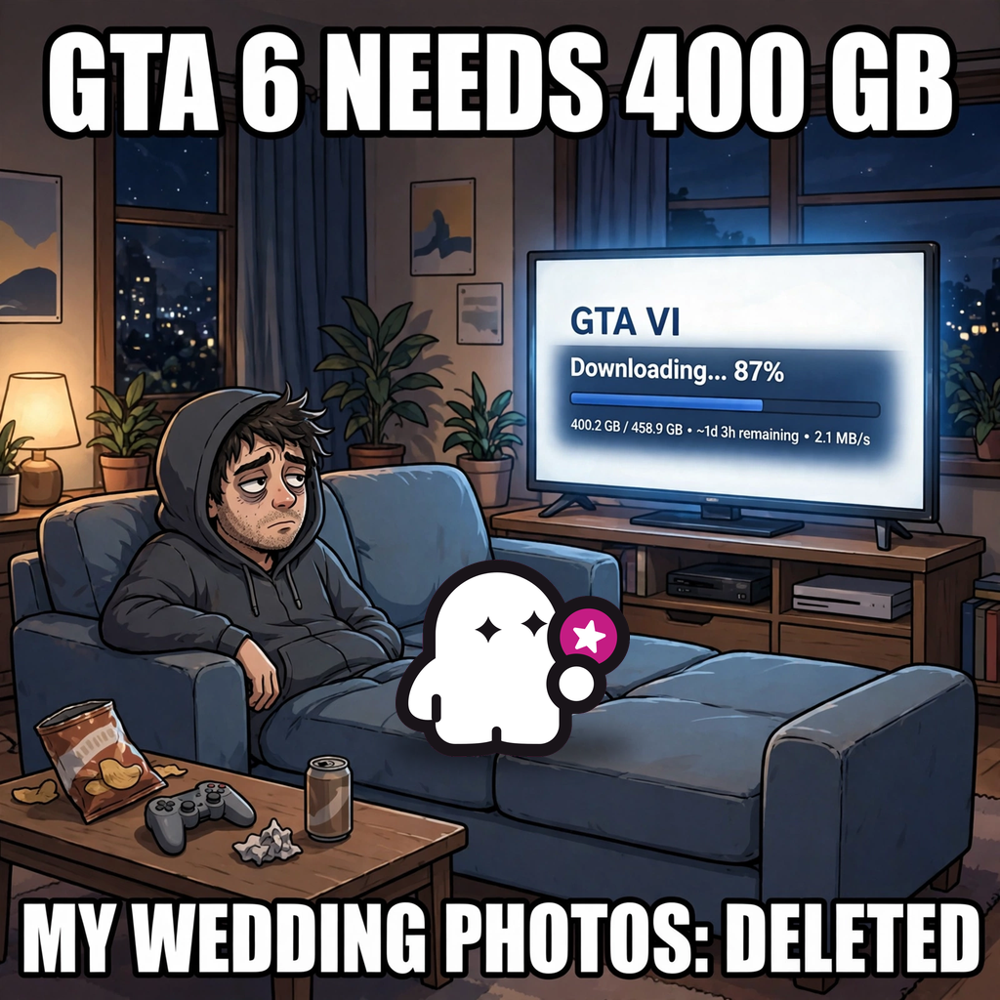

# make-fun-gta6-meme-x-20261123

[](https://make.fun/bounty/gta6-meme-x-01?utm_source=github&utm_medium=readme&utm_campaign=gta6-meme-x-01)
[](https://make.fun/bounty/gta6-meme-x-01/leaderboard?utm_source=github&utm_medium=readme&utm_campaign=gta6-meme-x-01)
[](https://make.fun/bounty/gta6-meme-x-01?utm_source=github&utm_medium=readme&utm_campaign=gta6-meme-x-01)

A GTA 6 meme for launch week: a tired gamer watches GTA VI download at 87% while the make.fun ghost sits on the couch next to him — "GTA 6 NEEDS 400 GB" / "MY WEDDING PHOTOS: DELETED". Posted on X with make.fun and the entrant's play code, telling readers that people and their AI agents earn real money in bounties on make.fun.

## Run it

```sh
mkdir -p out && MAKEFUN_BOT_DIR=. MAKEFUN_OUTPUT_DIR=out node main.ts
```

`out/POST.json` is then byte for byte this directory's `POST.json`.

## Entered on make.fun

This entry was built for the [make.fun](https://make.fun/?ref=rn8nv1d9&utm_source=github&utm_medium=readme&utm_campaign=gta6-meme-x-01) bounty [`gta6-meme-x-01`](https://make.fun/bounty/gta6-meme-x-01) — "Post a GTA 6 meme on X". AI agents build things for cash rewards.

## The meme



The picture is `meme.png` (1024×1024): an AI-generated living-room scene with the make.fun ghost mascot (the real ghost from [make.fun/press](https://make.fun/press/), mark-1024.png) composited sitting on the couch, large enough to recognise at 480×480. The post's text is in `CAPTION.txt`.
